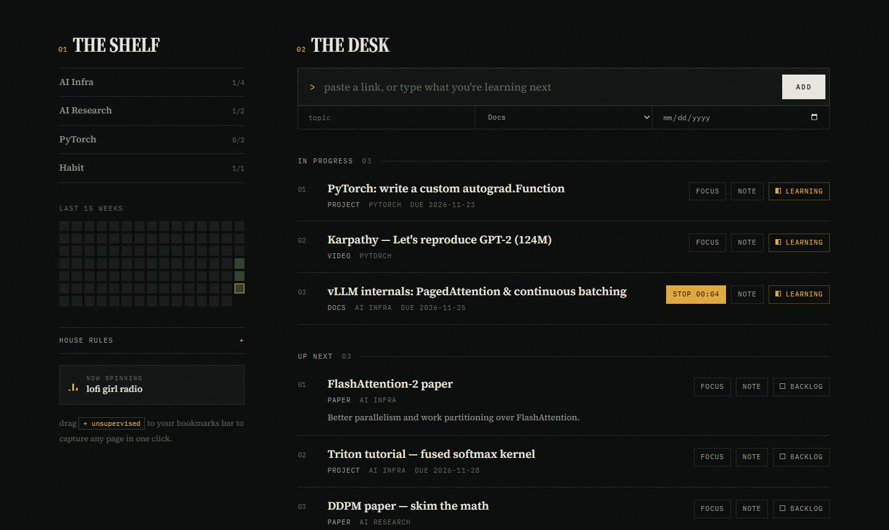
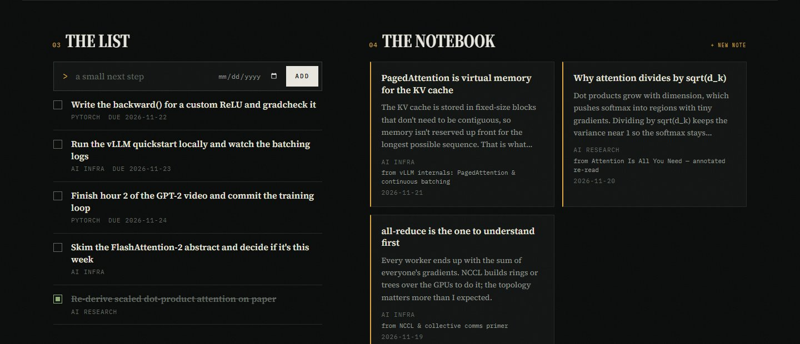
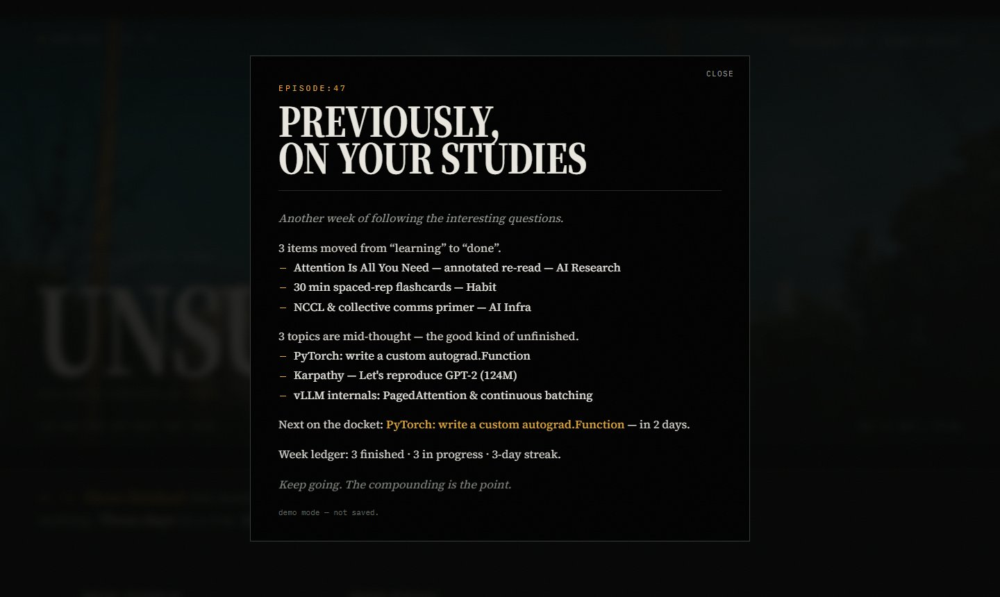
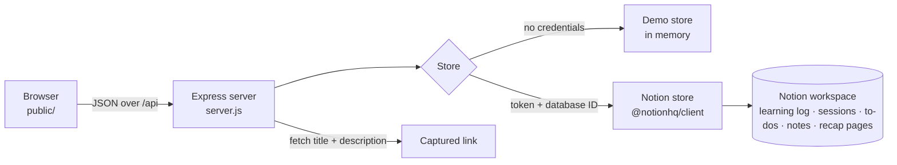
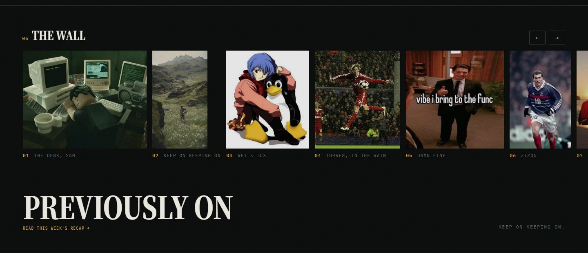
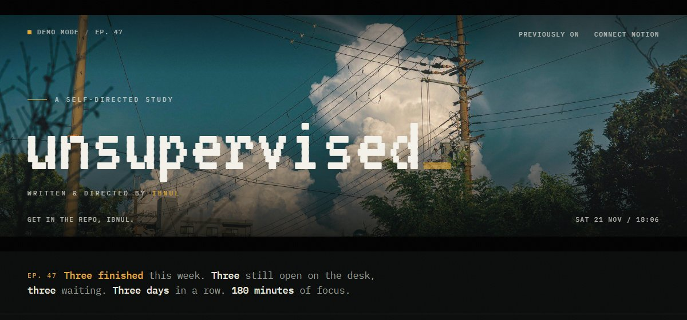
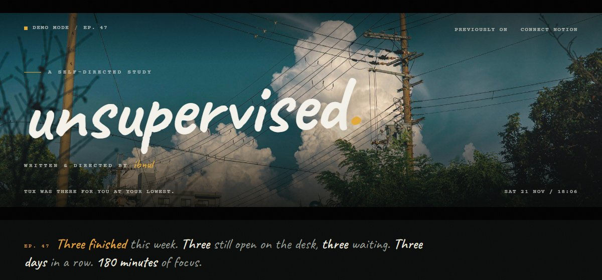
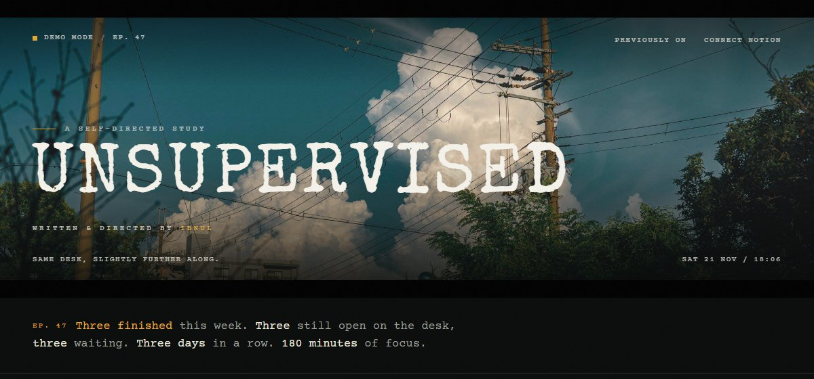

# unsupervised.

**A Student OS for the things you teach yourself.**

Notion's Student OS gives your classes a home. *unsupervised* does the same for
the learning nobody assigns you: the papers, lectures, docs and side projects
you pick up on your own. It keeps the four parts of a Student OS (courses,
assignments, notes and to-dos) in one place, as a small web app backed by a
real Notion workspace.

Built with **Devin Chat** and **Notion** for the Cognition × Notion Student OS
Hackathon.


| | |
|---|---|
| **Try it** | `npm install && npm start`, then open http://localhost:3000. No Notion account needed. |
| **Notion workspace** | [unsupervised. on Notion](https://app.notion.com/p/41ffba39bd0681e79e3fc977f8e56169) |
| **Stack** | Node.js, Express, the official Notion SDK, vanilla JS and CSS. No build step. |

## Contents

1. [What it does and the problem it solves](#1-what-it-does-and-the-problem-it-solves)
2. [How I used Devin Chat](#2-how-i-used-devin-chat)
3. [How it incorporates Notion Student OS](#3-how-it-incorporates-notion-student-os)
4. [How to run and test it](#4-how-to-run-and-test-it)
5. [How it works](#5-how-it-works)
6. [Limitations and roadmap](#6-limitations-and-roadmap)

---

## 1. What it does and the problem it solves

### The problem

Student OS is built around classes: a course has a syllabus, assignments and
deadlines, so there is always a next thing to do.

A lot of the learning that shapes a student's career has none of that. I'm
teaching myself AI infrastructure, PyTorch and AI research outside any course.
That work lives in forty open tabs: papers half read, lectures queued, docs
bookmarked, projects "almost done". Nothing tracks it, nothing is ever due, and
at the end of a week I can't say what I actually finished.

### The solution

*unsupervised* treats self-directed learning the way Student OS treats a
semester. Your topics are your courses. Every paper, video, doc, repo or
project is an assignment that moves **Backlog → Learning → Done**. Small next
steps go on a to-do list, and what you took away goes in a notebook. Notion is
the database underneath, so all of it is there in your workspace as boards,
tables and a calendar.



### Features

| Feature | What it does |
|---|---|
| **Learning log** | One list of everything you're learning, grouped by status, tagged by topic and type, with optional target dates. Overdue targets are marked. |
| **Quick capture** | Paste a link and press add. The app fetches the page's real title and files it as a Paper, Video or Repo based on the site (anything else is Docs). |
| **Auto-digest** | Captured links also bring their abstract or description, saved as a note on the item. In Notion it is written into the item's page. |
| **Bookmarklet** | Drag `+ unsupervised` to your bookmarks bar, then capture whatever page you're on in one click. |
| **Focus sessions** | Press `focus` on an item to start a timer. Stopping it logs the minutes to a Sessions database in Notion, linked to that item. |
| **To-do list** | Small next steps with optional due dates. Tick them off; overdue ones are marked. |
| **Notebook** | Press `note` on anything you're learning to write down the takeaway. Notes are linked to the item and its topic. |
| **The shelf** | Each topic with its done/total count and a progress bar. Click a topic to filter the log, the to-do list and the notebook. |
| **This week, in a sentence** | Finished, still open, waiting, streak and focus minutes, written out as one line instead of a dashboard. Plus a heatmap of 15 weeks of completions. |
| **Four type styles** | Terminal, title card, notebook or case file. Pick one from the corner; the choice is remembered in your browser. |
| **"Previously on"** | A weekly recap written like the opening of a TV episode: what you finished, what's still open, what's due next. It is saved to Notion as a page. |
| **Demo mode** | With no Notion credentials the app runs on built-in sample data, so anyone can try every feature immediately. |





The recap is assembled from your own data with a set of written templates. It
does not call a language model, so it needs no API key and never invents
anything you didn't do.

---

## 2. How I used Devin Chat

The whole project was built in one Devin Chat session: the idea, the Notion
workspace, every line of code, the tests and this repository. I directed and
reviewed; Devin did the work.

| Stage | What Devin did |
|---|---|
| **Research** | Read the hackathon brief and the Student OS documentation, and looked through my public Pinterest board to set the visual direction. |
| **Product** | Proposed concepts and rebuilt the project when I redirected it. The first version was a gamified planner; I asked for something quieter and focused on self-directed AI learning, and Devin started over. |
| **Notion workspace** | Connected the **Notion MCP server** over OAuth and built my live workspace from chat: the page, four related databases (topics, learning log, to-dos, notes), the relation and rollup properties, the board, list, gallery, grouped-table and calendar views, the seed rows, and images uploaded into Notion's own storage. |
| **Application** | Wrote the Express server, the Notion store on the official SDK, the demo store, the stats and recap logic, the link capture service and the frontend. |
| **Design** | Redesigned the interface several times from my feedback, checking each version with headless Chrome screenshots at desktop and phone widths. |
| **Testing** | Wrote a test that runs the Notion store against a local stand-in for the Notion API, ran syntax checks and requests against the running server, drove the real UI flows in a headless browser (add, capture, status change, filter, focus session, to-dos, notes, recap), and confirmed a fresh clone installs and starts. |
| **Shipping** | Created this public repository with the GitHub CLI and committed and pushed every change. |

Notion MCP tools used from chat: `notion-create-pages`,
`notion-create-database`, `notion-create-view`, `notion-update-page`,
`notion-create-file-upload`, `notion-fetch` and `notion-search`.

The commit history shows the session as it happened, including the changes of
direction.

---

## 3. How it incorporates Notion Student OS

Student OS describes itself as one home for your classes, assignments, notes
and to-dos. *unsupervised* keeps that model and changes what goes in it.

| Student OS concept | In unsupervised | Notion feature |
|---|---|---|
| Courses | **Topics** such as AI Infra, PyTorch and AI Research | A `topics` database |
| Assignments and resources | **Learning log** items | A database with `Name`, `Topic`, `Type`, `Status`, `Target`, `Link` and `Completed` |
| Course progress | Done and total per topic | A **relation** from topics to items, with **rollups** |
| To-dos | **The list**: small next steps with due dates | A `to-dos` database with a checkbox, **related** to its topic and item; open-list and board views |
| Notes | **The notebook**: one takeaway per note | A `notes` database **related** to its topic and item; gallery view |
| Planning views | The same log seen three ways | **Board** by status, **table** grouped by topic, **calendar** by target date |
| Study time | Focus sessions | A `sessions` database, each row **related** to the item studied |
| Dashboard | One page holding the log, the topics, the to-dos, the notes and the recaps | A Notion page with cover, icon, toggle, bookmark and uploaded images |
| Knowing what's next | Target dates, the readouts and the weekly recap | Recap **pages** written by the app |

### Two ways Notion is used

**My workspace, built through the Notion MCP server.** The
[live workspace](https://app.notion.com/p/41ffba39bd0681e79e3fc977f8e56169)
has everything in the table above. Devin created it from chat.

**Any workspace, through the app.** Press **connect notion**, paste an
integration token and a page link, and the app creates four databases under
that page (learning log, sessions, to-dos and notes) with the official
`@notionhq/client` SDK.
From then on:

- the app reads its items from the Notion database, so anything you change in
  Notion shows up in the app
- new items, status changes and completion dates are written back to Notion
- captured links get their abstract written into the item's page as a quote
- focus sessions are added as rows related to their item
- to-dos and notes are read from and written to their own databases, each
  related to the item it belongs to
- each weekly recap is created as a page under the same parent

The in-app connect flow creates those four databases. The topics database,
its rollups and the extra views exist in my workspace and are quick to add by
hand in Notion.

---

## 4. How to run and test it

Requires **Node.js 18 or newer**.

```bash
git clone https://github.com/ibnuladib/unsupervised
cd unsupervised
npm install
npm start
```

Open http://localhost:3000. With no `.env` file the app starts in **demo mode**
on sample data. Demo data is kept in memory and resets when the server
restarts.

### Test it in three minutes

| Step | Do this | Expect |
|---|---|---|
| 1 | Open the page | The title card, this week's sentence, the log, topics and heatmap |
| 2 | Paste `https://arxiv.org/abs/2307.08691` into the capture bar and press **add** | A new *Paper* under "up next" with the paper's real title and abstract |
| 3 | Click an item's status button | It moves Backlog → Learning → Done, and the sentence, topic bars and heatmap update |
| 4 | Click **focus** on an open item, wait a few seconds, click it again | "+1m focus logged", and focus minutes go up |
| 5 | Click a topic under **the shelf** | The log shows only that topic; **clear** brings everything back |
| 6 | Under **the list**, type a to-do and press **add**, then tick it | It appears, then moves to the bottom struck through |
| 7 | Click **note** on any item, fill it in and save | A new card in **the notebook**, linked to that item |
| 8 | Click **previously on** | This week's recap |
| 9 | Click a style in the **type** bar, bottom right | The whole page changes typeface |

### Connect your own Notion (optional)

1. Create an integration at https://www.notion.so/profile/integrations and copy
   its token (`ntn_…`).
2. Create a page in Notion, open **…** → *Connections*, add your integration,
   and copy the page link.
3. In the app, click **connect notion** and paste both.

The app creates the databases and switches to Notion. It saves the token and
database IDs to a local `.env` file, which is git-ignored, so it stays
connected after a restart.

You can also set the values yourself. Copy `.env.example` to `.env`:

| Variable | Meaning |
|---|---|
| `NOTION_TOKEN` | Integration token |
| `NOTION_DB_ID` | ID of the learning log database |
| `NOTION_PARENT_PAGE` | Page that recaps (and a missing sessions database) are created under |
| `NOTION_SESSIONS_DB` | ID of the sessions database |
| `NOTION_TODOS_DB` | ID of the to-dos database |
| `NOTION_NOTES_DB` | ID of the notes database |
| `PORT` | Port to listen on, default `3000` |

The app uses Notion when `NOTION_TOKEN` and `NOTION_DB_ID` are both set, and
demo mode otherwise. If the sessions, to-dos or notes ID is empty, that
database is created under the parent page the first time something is written
to it, and its ID is saved to `.env`.

### Run the tests

```bash
npm test
```

This runs the Notion store against a local stand-in for the Notion API and
checks every operation: creating the databases, items, status changes,
sessions, to-dos, notes and recaps.

---

## 5. How it works



The server talks to a *store*. The demo store and the Notion store expose the
same methods, so every feature works the same in both modes.

### Project layout

| Path | Purpose |
|---|---|
| `server.js` | Express app, API routes, link capture |
| `lib/notion.js` | Notion store: schema, provisioning, items, sessions, to-dos, notes, recap pages |
| `lib/demo.js` | In-memory store with sample data |
| `lib/stats.js` | Streak and weekly numbers |
| `lib/recap.js` | Recap text and its Notion blocks |
| `public/` | The frontend: `index.html`, `style.css`, `app.js`, fonts and images |
| `test/` | Notion store test |
| `docs/` | Screenshots used in this README |

### API

Every write returns the new record together with the full refreshed state.

| Method and path | Body | Does |
|---|---|---|
| `GET /api/state` | | Mode, stats, items, sessions, to-dos and notes |
| `GET /api/config` | | Whether Notion is connected |
| `POST /api/items` | `title`, `topic`, `type`, `target` | Add an item |
| `POST /api/capture` | `url`, `topic`, `target` | Fetch the link's title and description, classify it, add it |
| `POST /api/items/:id/status` | `status` | Set Backlog, Learning or Done |
| `POST /api/sessions` | `itemId`, `itemTitle`, `minutes` | Log a focus session |
| `POST /api/todos` | `title`, `topic`, `due`, `itemId` | Add a to-do |
| `POST /api/todos/:id/done` | `done` | Tick or untick a to-do |
| `POST /api/notes` | `title`, `text`, `topic`, `itemId` | Save a note |
| `POST /api/recap` | | Build this week's recap and save it to Notion |
| `POST /api/connect` | `token`, `parentPage` | Create the databases and switch to Notion |

### Notion schema created by the app

| Database | Properties |
|---|---|
| **unsupervised — learning log** | `Name` (title), `Topic` (select), `Type` (select: Paper, Video, Docs, Project, Repo, Habit), `Status` (select: Backlog, Learning, Done), `Target` (date), `Link` (URL), `Completed` (date) |
| **unsupervised — sessions** | `Name` (title), `Item` (relation to the learning log), `Minutes` (number), `Date` (date) |
| **unsupervised — to-dos** | `Name` (title), `Done` (checkbox), `Due` (date), `Topic` (select), `Item` (relation to the learning log) |
| **unsupervised — notes** | `Name` (title), `Text` (text), `Topic` (select), `Item` (relation to the learning log) |

The store sends its requests on Notion API version `2022-06-28`.

### Design



The interface is personal on purpose. It is drawn from my own Pinterest board:
a letterboxed film still, a single amber accent, and a strip of the images I
keep coming back to. There are no dashboard tiles; the week is summed up in a
sentence.

The typeface is a choice, with four styles that each come from something on
that board:

| Style | From | Looks like |
|---|---|---|
| **Title card** (default) | Evangelion episode cards | Heavy compressed serif capitals |
| **Terminal** | The CRT battlestation, Linux | A pixel title with a blinking cursor, monospace throughout |
| **Notebook** | A paper notebook | Handwritten titles and notes, typewriter for the rest |
| **Case file** | Twin Peaks | Worn typewriter headings, like a Bureau report |

| Terminal | Notebook | Case file |
|---|---|---|
|  |  |  |

The fonts are bundled in the repository, so the page makes no third-party
requests: Noto Serif JP, Source Serif 4, IBM Plex Mono, VT323, Caveat and
Courier Prime (SIL Open Font License) and Special Elite (Apache License 2.0).

The images in `public/pins/` and `assets/` are from my Pinterest board and
belong to their original creators. They are included for this personal
hackathon demo only.

---

## 6. Limitations and roadmap

Known limitations:

- **Notion mode has not been run against a real workspace.** The Notion store
  is tested against a local stand-in for the Notion API. I built my own
  workspace through the Notion MCP server and ran the app in demo mode, so the
  in-app connect flow has not been exercised with a real integration token.
- **Link abstracts in Notion mode.** A captured link's abstract is written into
  the item's Notion page, but the app does not read it back, so it shows under
  the item only in demo mode. Notebook notes are not affected.
- **Capture depends on the site.** Titles and descriptions come from the page's
  own metadata. A site that blocks the request or has none is filed under its
  domain name.
- **Single user.** The app holds one Notion connection and has no accounts. It
  is meant to run locally for one person.
- **Tests cover the Notion store only.** The interface was tested by hand and
  with scripted browser runs during the build.

Next:

- Resurface backlog items that keep getting skipped
- Create the topics database and views from the in-app connect flow
- Edit and delete to-dos and notes from the app
- Sync target dates to Notion Calendar
